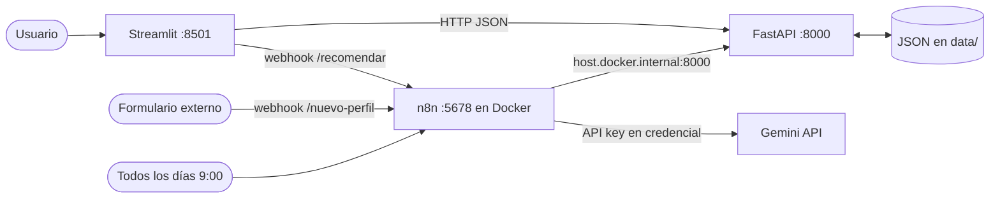

# Arquitectura de Nextia

## Recorrido de datos (proceso principal)

1. El usuario carga estudiantes y ofertas en **Streamlit**, que las envía a **FastAPI** (`POST`).
2. FastAPI valida con **Pydantic** y guarda en **JSON** (`data/`).
3. Al calcular compatibilidad, Streamlit llama a `POST /compatibilidad`; la API ejecuta
   `app/scoring.py` (reglas de Python) y guarda el resultado.
4. Si el usuario pide recomendaciones, Streamlit envía el resultado al webhook `/recomendar` de **n8n**.
5. n8n decide: si el score es menor a 70, arma el prompt, consulta a **Gemini**, valida la
   respuesta y la guarda en la API con `POST /recomendaciones` (estado `pendiente`).
6. Una persona aprueba o descarta la recomendación desde Streamlit (`PUT /recomendaciones/{id}`).
7. Cada día, el workflow 3 lee `/resultados` y guarda un reporte con los candidatos destacados.

## Separación de responsabilidades

| Capa | Archivo(s) | Responsabilidad |
|---|---|---|
| Interfaz | `interfaz/streamlit_app.py` | Mostrar y recoger datos; no calcula ni guarda |
| API | `app/main.py` | Endpoints, códigos HTTP, orquestación |
| Contratos | `app/modelos.py` | Validación de datos de entrada |
| Reglas | `app/scoring.py` | Cálculo del score y competencias faltantes |
| Persistencia | `app/almacenamiento.py` | Lectura y escritura de JSON |
| Automatización | `n8n/workflows/*.json` | Flujos con decisiones y llamadas a la API e IA |
